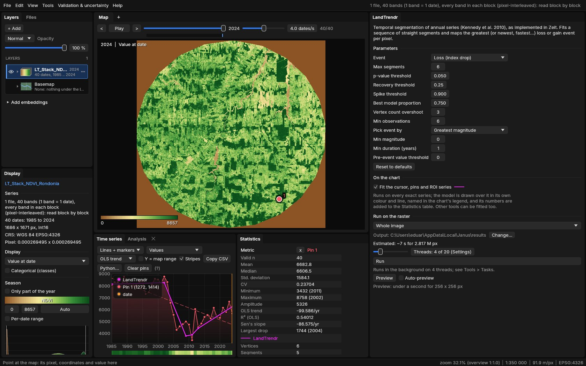

<p align="center">
  <picture>
    <source media="(prefers-color-scheme: dark)" srcset="branding/png/janus-horizontal-1024.png">
    
  </picture>
</p>

<p align="center">
  <b>Explore, analyse and validate raster time series and data cubes.</b>
</p>

<p align="center">
  <a href="https://github.com/sacridini/janus/actions/workflows/build.yml"></a>
  <a href="https://github.com/sacridini/janus/releases/latest"></a>
  <a href="https://doi.org/10.5281/zenodo.24515398"></a>
  
</p>

<p align="center">
  <a href="https://sacridini.github.io/janus/"><b>Website</b></a> ·
  <a href="https://github.com/sacridini/janus/releases/latest">Download</a> ·
  <a href="https://sacridini.github.io/janus/guides.html">Guides</a> ·
  <a href="https://sacridini.github.io/janus/docs.html">Docs</a> ·
  <a href="https://sacridini.github.io/janus/news.html">News</a>
</p>

[](https://sacridini.github.io/janus/landtrendr.html)

Janus is a desktop program to look at satellite imagery through time: find
where, when and by how much the land changed, and measure how far your map can
be trusted. The change detection comes from
[Zeit](https://github.com/sacridini/zeit-cdts), which is part of Janus:
nothing else to install. Its command line is `jn`.

## What it does

**Explore.** Open a folder, a multiband file, a wildcard, cloud-optimized
GeoTIFFs over `https://` or `s3://`, a STAC search (Sentinel-2, Landsat, Brazil
Data Cube) or a NetCDF/Zarr cube. Hover a pixel and its series is on the chart;
pin places, draw regions, compare layers side by side or with a swipe. Map
modes and composites run on the GPU; the 275 spectral indices, a raster
calculator, embeddings (AlphaEarth, TESSERA) and hyperspectral spectra too.
[Guide](https://sacridini.github.io/janus/visualize.html)

**Detect.** 34 methods from Zeit: LandTrendr, CCDC, BFAST, CODED, EWMACD,
trends and hot spots, phenology, unmixing, segmentation, and FORCE's Level 2,
NBAR and time series analysis. Fit one on the chart, tune it, then run it on
the image; or train deep learning models (TempCNN, L-TAE, Presto, U-TAE) on
your samples and delineate fields. Every run is kept as a Python script that
reproduces it. [Methods](https://sacridini.github.io/janus/methods.html)

**Prove.** Stratify a map, draw a sample, and interpret its points blind,
with image cards of every date and Esri Wayback's high-resolution image of
every year; one label per point or per year, or the fraction of each class.
Accuracy and error-adjusted areas with confidence intervals (Olofsson et al.
2014) come live as you label; several interpreters, adjudication, an HTML
report. [Guide](https://sacridini.github.io/janus/validation.html)

## Install

Download the package for your system from the
[latest release](https://github.com/sacridini/janus/releases/latest). Each one
carries GDAL and Zeit.

| System | Package |
|---|---|
| Windows | `janus-<version>-setup.exe`: per-user installer, optional `jn` on `PATH` and *Open in Janus* in the right-click menu |
| macOS 15+ (Apple Silicon) | `janus-<version>-macos-arm64.dmg`: drag Janus to Applications; not notarized, so open it the first time with right click → Open |
| Linux x86_64 | `janus-<version>-linux-x86_64.tar.xz`: portable, extract and run `jn` |

Details: [docs/install.md](docs/install.md).

## Quick start

```
jn D:\data\ndvi_annual\        # every raster in the folder, 1 file = 1 date
jn landsat_stack.tif           # 1 multiband file, 1 band = 1 date
jn "S2_*_NDVI.tif" --band 1    # a wildcard pattern
```

Or drop a folder on the window. Hover for a pixel's series, click to pin it,
`←` `→` to change the date, `S` for a satellite basemap. The rest is under
**Help → Shortcuts and usage**, and the [guides](https://sacridini.github.io/janus/guides.html)
go step by step on real data.

## Documentation

- [Usage](docs/usage.md): the command line, every interaction and tool
- [Building from source](docs/building.md): Rust and GDAL on Windows, Linux and macOS; the tests and packages
- [Architecture](docs/architecture.md): from the files to the GPU, and the crates
- [IDEIAS.md](IDEIAS.md) (Portuguese): roadmap, decisions and the measurements behind them

## License and credits

Janus is free software under the GNU General Public License, version 3 or
later ([LICENSE](LICENSE)), as is Zeit.

Some of it follows other people's work:
[Validation Viewer](https://scm.cms.hu-berlin.de/baumamat/validationviewer)
by Dr. Matthias Baumann (HU Berlin), the model of the interpretation view,
parts of its code ported to Rust;
[FORCE](https://github.com/davidfrantz/force) by David Frantz (Level 2, NBAR,
ImproPhe and the time series analysis, through Zeit);
[remotePARTS](https://github.com/morrowcj/remotePARTS) (the regional trend test);
[Awesome Spectral Indices](https://github.com/awesome-spectral-indices/awesome-spectral-indices);
WRI's Trazo and Fields of The World (field delineation). The Wayback images
are Esri's (Esri, Maxar, Earthstar Geographics, and the GIS User Community)
and their terms of use apply. If Janus helps your work, cite it with
[CITATION.cff](CITATION.cff).

Built in Rust with [egui](https://github.com/emilk/egui),
[wgpu](https://wgpu.rs) and [GDAL](https://gdal.org).
