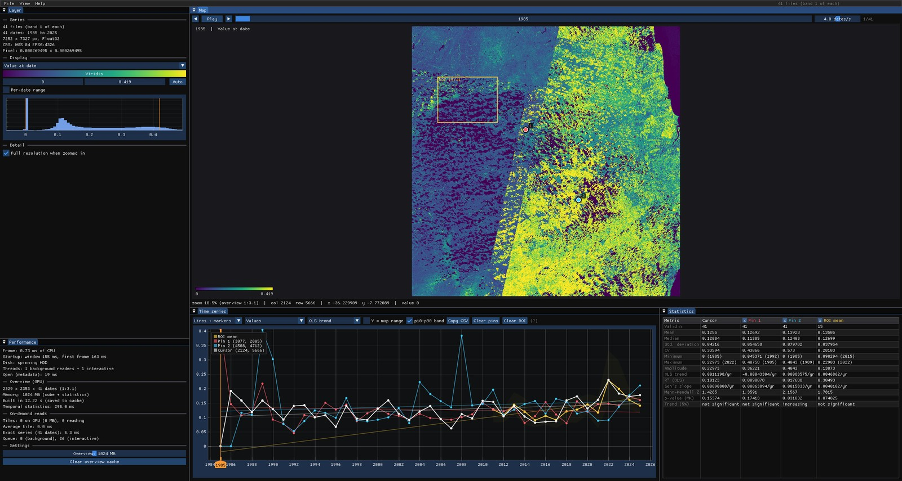

<p align="center">
  <picture>
    <source media="(prefers-color-scheme: dark)" srcset="branding/png/janus-horizontal-1024.png">
    
  </picture>
</p>

<p align="center">
  <b>Explore, analyse and validate raster time series and data cubes.</b>
</p>

<p align="center">
  <a href="https://github.com/sacridini/janus/actions/workflows/build.yml"></a>
  <a href="https://github.com/sacridini/janus/releases/latest"></a>
  
</p>

<p align="center">
  <a href="https://sacridini.github.io/janus/"><b>Website</b></a> ·
  <a href="https://github.com/sacridini/janus/releases/latest">Download</a> ·
  <a href="docs/usage.md">Documentation</a> ·
  <a href="IDEIAS.md">Roadmap</a>
</p>



With Janus you explore satellite imagery pixel by pixel, find where, when and
by how much the land changed, and measure how accurate your maps are. The
change detection comes from [Zeit](https://github.com/sacridini/zeit-cdts),
which ships with Janus: there is nothing else to install. Its command line is `jn`.

## Features

- **Opens any stack of rasters**: a folder (one file per date), a multiband file
  (one band per date), a list of files or a wildcard; dates come from file names
  or band descriptions.
- **Cloud-native**: cloud-optimized GeoTIFFs straight from `https://`, `s3://`,
  `gs://` or `az://` (File → Open URL, or `jn https://...`), reading only the
  blocks and overview levels on screen.
- **Climate cubes**: NetCDF, Zarr and HDF variables with CF time (model
  calendars included), levels and a variable picker.
- **14 map modes on the GPU**: value, anomaly, difference to a reference date,
  temporal statistics, trend, largest drop (date and magnitude), multitemporal
  RGB, temporal composites (median, mean, max... of a year or a moving window);
  a **season** (days of the year) for the statistics and composites; changing
  date, colormap or stretch is instant.
- **Pixel series as you hover**, pins to compare places, a region (a rectangle,
  a polygon or a freehand outline) with its mean and p10–p90 band; OLS and Sen
  trends.
- **Vector layers** (GeoJSON, Shapefile, GeoPackage, KML, CSV of points) over
  the map in any CRS: the series of every plot or parcel extracted to a CSV
  table, and a TimeSync-style **interpretation** mode to label samples with
  the keyboard.
- **Map validation** (Olofsson et al. 2014): strata from any map (classes,
  intervals, dates of change, the agreement of several maps, a buffer around
  change), sample size and allocation, a stratified random sample in a
  GeoPackage project, blind interpretation of its points with chips of every
  date, and the accuracy and **error-adjusted areas ± confidence intervals**
  of every map assessed with it (LandTrendr × CCDC × BFAST × MapBiomas...),
  live as labels come; several interpreters, kappa and adjudication; an HTML
  report and the matching `zeit.accuracy` code. Step by step, with
  screenshots: [Validating a map](https://sacridini.github.io/janus/validation.html).
- **Compare**: several series as layers, in any CRS (reprojected on the GPU),
  map panels side by side, a swipe divider, and space-time transects
  (distance × date) along a line, a polyline or a vector line.
- **Basemap** under the series: Esri World Imagery, Sentinel-2 cloudless,
  OpenStreetMap or your own XYZ tiles; off until you pick one.
- **Categorical series** (land cover, classifications) with class colours,
  names and change summaries; **several bands per date** with normalized
  differences, cloud masks and **RGB composites** (true colour, colour
  infrared...) while the chart keeps the index.
- **Change detection built in**: LandTrendr, Mann-Kendall, BFAST, CCDC,
  CODED (forest degradation, with the NDFI), phenology, TWDTW, SOM clustering,
  SNIC segmentation, Tmask cloud screening and more from [Zeit](https://github.com/sacridini/zeit-cdts),
  fitted live on the chart (BFAST and CCDC models drawn over the series) or
  run on the image (also CCDC's cloud-free synthetic image of a date), plus
  the agreement of several change maps. **Copy Python** gives the code that
  reproduces a series and the tool's Zeit calls. Zeit's methods are part of
  Janus: no Python to install, and a fit takes under a millisecond.
- **Spectra** (hyperspectral, e.g. EnMAP): a file whose bands have
  wavelengths opens with the chart in nanometres, the spectrum of the cursor,
  pins and region, and true-colour, colour-infrared and SWIR composites;
  index maps (NDVI, red edge, PRI...), principal components and spectral
  similarity, and series of scenes by wavelength.
- **Embeddings** of foundation models (AlphaEarth, TESSERA): downloaded for the
  visible area over any series, shown through their principal components (also
  local to a region, refitted as you move it), the similarity to the cursor or
  a pin, and the change between years; computed with SIMD kernels.
- **Export**: maps as PNG figures, timelapse **animations** (GIF, MP4, WebM)
  with the date, legend and scale bar, values, views, Zeit results and
  embedding views as georeferenced GeoTIFFs, series as CSV.
- **Fast on any disk**: about 0.15 s to the first frame, a disk cache of the
  cube, and a full-resolution cache that serves a pixel's series in about 1 ms
  even when the data sit on a spinning hard disk.

## Install

Download the package for your system from the
[latest release](https://github.com/sacridini/janus/releases/latest). Each one
carries GDAL, and Zeit is part of the program: nothing else to install.

| System | Package |
|---|---|
| Windows | `janus-<version>-setup.exe`: per-user installer, optional `jn` on `PATH` and *Open in Janus* in the right-click menu |
| macOS 15+ (Apple Silicon) | `janus-<version>-macos-arm64.dmg`: drag Janus to Applications; not notarized, so open it the first time with right click → Open |
| Linux x86_64 | `janus-<version>-linux-x86_64.tar.xz`: portable, extract and run `jn` |

Details for each system: [docs/install.md](docs/install.md).

## Quick start

```
jn D:\data\ndvi_annual\        # every raster in the folder, 1 file = 1 date
jn landsat_stack.tif           # 1 multiband file, 1 band = 1 date
jn "S2_*_NDVI.tif" --band 1    # a wildcard pattern
```

Or open a folder from the **File** menu, the **Files** panel, or by dropping it
on the window. Then:

| | |
|---|---|
| Hover | the pixel's series (exact once the mouse rests) |
| Click / `Shift` + drag / `R` | drop a pin / draw a region / draw a polygon |
| `Alt` + click | a polygon of a vector layer becomes the region |
| `←` `→` / `P` | previous or next date / play |
| `Ctrl` + drag / `C` | space-time transect / swipe |
| `S` / `Space` / `F` | satellite basemap / show or hide the active layer / fit the map |
| `Ctrl+T` / `Ctrl+W` | open / close a map panel |

Everything else is in [docs/usage.md](docs/usage.md) and under **Help →
Shortcuts and usage**.

## Documentation

- [Usage](docs/usage.md): command line, every interaction, the Zeit tools, performance notes
- [Installation](docs/install.md): details for Windows, macOS and Linux
- [Building from source](docs/building.md): Windows, Linux and macOS, the tests, packages
- [Architecture](docs/architecture.md): how the cube flows from the files to the GPU, and the crates
- [RUST_MIGRATION.md](RUST_MIGRATION.md) (Portuguese): how Janus moved from C++ to Rust for 1.0, with the measurements
- [IDEIAS.md](IDEIAS.md) (Portuguese): roadmap, design decisions and the measurements behind them

## Building

Janus is written in Rust. It needs GDAL (e.g. from conda-forge); everything
else comes from crates.io.

```
cargo build --release
```

See [docs/building.md](docs/building.md) for pointing the build at GDAL on each
platform, the tests and the packages.

## License

Janus is free software under the GNU General Public License, version 2 or
later ([LICENSE](LICENSE)), as is [Zeit](https://github.com/sacridini/zeit-cdts).

---

Built with [egui](https://github.com/emilk/egui), [wgpu](https://wgpu.rs) and
[GDAL](https://gdal.org); Direct3D 12 on Windows, Vulkan on Linux, Metal on
macOS. Change detection by [Zeit](https://github.com/sacridini/zeit-cdts). Janus
was written in C++ (Dear ImGui, ImPlot, GLFW) up to 0.39, and called *tsv* up
to 0.16.
